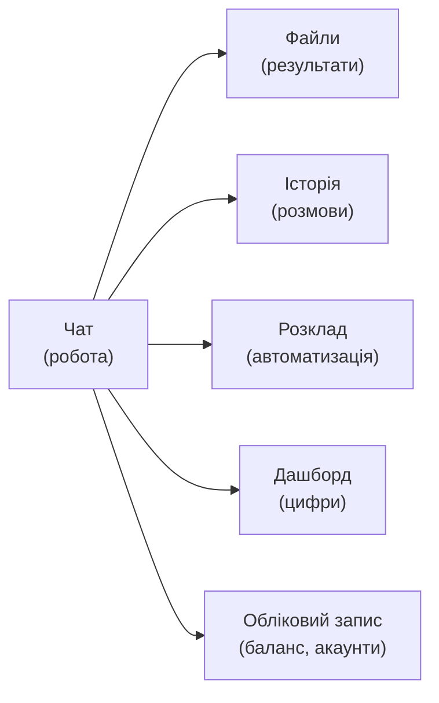
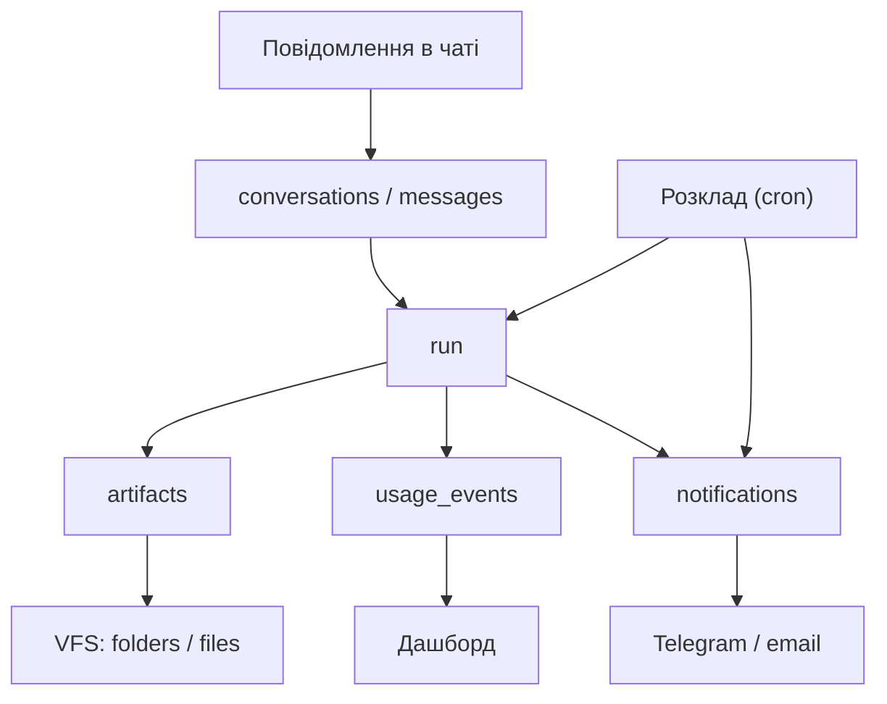

## 31. Медіа, голос і генерація

### 31.1. Принцип

Медіа — це **набір інструментів**, не зміна ядра (§1.6, R2). Кожна можливість нижче додається
пакетом `packages/modules/media/` і реєструється як `ToolDefinition`. Жодних правок у runtime.

**Уточнення до §23.10:** там сказано «голосовий агент (телефонія) — не робимо». Це про **дзвінки**
(окремий ринок, телефония). Тут — **голосовий ввід/вивід у застосунку**, що є просто ще одним
інтерфейсом до того самого агента.

### 31.2. Голос: ввід і вивід

| Напрямок | Рішення | Локально/хмара | Вартість |
|---|---|---|---|
| **STT** (слухати) | `faster-whisper` (CTranslate2) | Локально, CPU/GPU | $0 |
| STT (складне аудіо) | Whisper API / Groq Whisper | Хмара | ~$0.006/хв |
| **TTS** (озвучувати) | `edge-tts` (Microsoft) | Хмара, безкоштовно | $0 |
| TTS (якісний) | ElevenLabs | Хмара | ~$0.10/1000 символів |
| TTS (локальний) | **Piper** | Локально | $0 |

**Чому два рівні:** `edge-tts` дає прийнятну українську голосом «Оксана/Дмитро» безкоштовно — цього
достатньо для 95% сценаріїв. ElevenLabs — коли клієнт хоче «свій голос» (бренд-войсовер).

**Інтерфейси:**

```
1. Мікрофон у чаті        — запис → STT → звичайний текстовий запит
2. Голосове повідомлення в Telegram — вже готовий канал (§15.5)
3. Озвучення відповіді    — кнопка «🔊» на кожному повідомленні
4. Дзвінок-режим          — push-to-talk у браузері (WebRTC), пізніше
```

**Ключова деталь:** голос — це **ввід**, а не інший агент. Після STT запит іде тим самим шляхом
(§3.3). Це означає: жодної окремої логіки, жодних нових станів.

```ts
interface MediaToolkit {
  transcribe(audio: ArtifactRef, opts: { lang?: string; diarize?: boolean }): Promise<Transcript>;
  synthesize(text: string, opts: { voice: string; speed?: number }): Promise<ArtifactRef>;
}
```

**Обмеження, які треба показати користувачу:** 25 МБ / 60 хв на файл; мова визначається автоматично,
але `uk`/`en` — найкраще; шумний запис дає 80–90% точності проти 97% на чистому.

### 31.3. Розуміння відео й аудіо

| Задача | Підхід | Вартість |
|---|---|---|
| Транскрипція | Whisper (+ `whisperx` для діаризації: «хто говорить») | $0 локально |
| Конспект відео | транскрипт → LLM (long-context) | ~$0.01/год відео |
| Ключові кадри | `ffmpeg` scene detection → 8–12 кадрів → VLM | ~$0.002 |
| Субтитри | Whisper → `.srt` | $0 |
| Пошук по відео | транскрипт із таймкодами → pgvector | — |

**Ліміти:** 500 МБ / 2 год на файл; обробка у пісочниці (ffmpeg — нативний бінарник, §5.3);
черга окремо від інтерактивних задач, бо обробка відео — хвилини, а не секунди.

**Сценарій-вбивця:** «Ось запис дзвінка з клієнтом — зроби конспект, знайди домовленості й занеси
в CRM». Це з'єднання §31.3 + §14.6.

### 31.4. Генерація зображень

| Провайдер | Якість | Ціна | Коли |
|---|---|---|---|
| **gpt-image-1** | Висока, добре розуміє текст на картинці | ~$0.04–0.17/зобр. | Логотипи, банери з текстом |
| **Flux (Replicate/fal)** | Дуже висока, фотореалізм | ~$0.003–0.05 | Фото, ілюстрації |
| **SDXL локально** | Середня | $0 (GPU/CPU) | Масові варіації, приватність |
| Midjourney | Найвища художня | немає офіційного API | **Не інтегруємо** (порушення ToS) |

**Чому не Midjourney:** він не має публічного API, а автоматизація через Discord-бота порушує його
умови. Пропонуємо Flux/gpt-image-1 — результат порівнянний, інтеграція легальна.

**Бренд-консистентність (те, за що платять):**

```
1. Клієнт завантажує 3–5 зразків свого стилю (логотип, кольори, шрифти)
2. Ми зберігаємо brand-kit у пам'яті тенанта (§6.4)
3. Кожен промпт автоматично доповнюється brand-контекстом
4. Reference-image (img2img) для збереження стилю
```

**Безпека й право:**

| Правило | Чому |
|---|---|
| Модерація промптів і результату | NSFW, насильство, дитячий контент — блок |
| Заборона генерації реальних людей | Deepfake-ризик; розпізнаємо імена публічних осіб |
| Водяний знак «AI» (опційно) | Прозорість; у ЄС — вимога AI Act для синтетики |
| Ліцензія результату — клієнту | Фіксуємо в Terms |
| Не генеруємо «стиль живого художника» за іменем | Етичний і юридичний ризик |

### 31.5. Аналіз таблиць (не лише створення)

§13.8 описує **генерацію** XLSX. Тут — **аналітика**: користувач кидає таблицю й питає.

| Задача | Інструмент | Приклад |
|---|---|---|
| Q&A по таблиці | `pandas` / `duckdb` у пісочниці | «Скільки ми витратили на логістику в жовтні?» |
| Зведені таблиці | `pandas.pivot_table` | «Зроби зріз по місяцях і категоріях» |
| Пошук аномалій | статистика (z-score, IQR) | «Знайди підозрілі суми» |
| Графіки | `matplotlib` / `vega-lite` → PNG/SVG | «Покажи динаміку за квартал» |
| Формули | відкриття й перерахунок через LibreOffice | «Перерахуй цю модель із новими цінами» |
| Порівняння двох файлів | `pandas.merge(indicator=True)` | «Що змінилось між версіями прайсу?» |

```ts
interface DataAnalysis {
  load(file: ArtifactRef): Promise<DatasetRef>;      // у пісочниці
  query(dataset: DatasetRef, question: string): Promise<AnalysisResult>;
  pivot(dataset: DatasetRef, spec: PivotSpec): Promise<AnalysisResult>;
  chart(dataset: DatasetRef, spec: ChartSpec): Promise<ArtifactRef>;
  diff(a: DatasetRef, b: DatasetRef, key: string[]): Promise<DiffResult>;
}
```

**Правила безпеки:**

| Правило | Чому |
|---|---|
| **Ніколи не виконувати макроси** (`.xlsm`) | Виконуваний код у файлі |
| Ліміт 100 000 рядків / 50 МБ | Інакше пам'ять пісочниці |
| Типи колонок визначаємо самі, не довіряємо файлу | Формули-ін'єкції (`=cmd|...`) |
| Формули не обчислюємо Python-ом — лише LibreOffice | Розбіжність у 1 копійку неприпустима |
| Числа з плаваючою точкою — `Decimal` для грошей | 0.1+0.2 ≠ 0.3 |

### 31.6. Вартість і ліміти

| Операція | Орієнтовно | Ліміт на Free |
|---|---|---|
| STT 10 хв | $0 (локально) | 60 хв/міс |
| TTS 1000 символів | $0 (edge-tts) | без ліміту |
| Генерація зображення | $0.004–0.17 | 20/міс |
| Конспект 1 год відео | $0.01 | 2/міс |
| Аналіз таблиці | $0.002 (модель) | 50/міс |

### 31.7. Шлях за $0

| Потреба | $0 | Обмеження |
|---|---|---|
| STT | `faster-whisper` (tiny/base/small) | CPU: 1×–4× реального часу |
| TTS | `edge-tts` | Потрібен інтернет, голоси Microsoft |
| Зображення | **SDXL локально** / безкоштовні квоти | Повільно на CPU |
| Відео | `ffmpeg` + Whisper | — |
| Таблиці | `pandas`/`duckdb` у пісочниці | — |

### 31.8. Ризики

| Ризик | Мітигація |
|---|---|
| Генерація зображень обходить copyright | Фільтр промптів, заборона «у стилі [художник]» |
| Голос використовують для скаму | AUP + модерація + KYC-lite (§8.7) |
| Відео забиває чергу | Окрема черга, ліміт паралельності |
| Хибні висновки по таблиці | Показуємо код запиту + перші 5 рядків джерела |

---

## 32. Робочий простір користувача

### 32.1. П'ять екранів замість одного чату

Зараз у §7.5 показано один екран. Реальній людині потрібно більше, інакше вона шукає свій звіт
у скролі чату.



### 32.2. Файловий менеджер

**Проблема:** агент створює 20 файлів на тиждень, і всі вони тонуть у чаті.

| Елемент | Реалізація |
|---|---|
| Дерево папок | VFS з §13.9 (`folders` / `files`) |
| Список файлів | Назва, тип, розмір, дата, звідки (run), теги |
| Пошук | `pg_trgm` по назві + повнотекстовий по вмісту (§23.5) |
| Перегляд | PDF/зображення/DOCX/XLSX — inline (без скачування) |
| Версії | Одна назва, кілька версій — історія змін |
| Дії | Скачати, перейменувати, перемістити, поділитись, видалити |
| Посилання | Публічне посилання з TTL (1 год – 7 днів) |
| Сортування | За датою/типом/розміром/папкою |
| Зв'язок із чатом | «Показати в чаті» → перехід до run, що створив файл |

**Ключове:** файл — це **першокласний об'єкт**, а не «вкладення до повідомлення». Тому він живе в
папках, має версії й доступний з будь-якого пристрою.

`TEST: агент створив 10 файлів у 3 папках → усі видно в менеджері без входу в чат; пошук за
назвою знаходить за 1 символ.`

### 32.3. Панель моніторингу (дашборд)

Не «внутрішній ops-дашборд» (§9.6), а **особиста аналітика користувача**.

| Блок | Що показує |
|---|---|
| **Зведення** | Задач виконано / провалено, успішність %, час зекономлено |
| **Витрати** | Кредити за період, розподіл: моделі / браузер / документи |
| **Топ-джерела** | Які сайти/сервіси використовуються найчастіше |
| **Топ-задачі** | Найчастіші запити → кандидати на автоматизацію (§30.3) |
| **Графіки** | Динаміка по днях, вартість на задачу |
| **Експорт** | CSV / PDF-звіт за місяць |

**Правило:** усі цифри — з `usage_events` (§7.6.3), не оцінки. Якщо даних немає — показуємо «—», а не 0.

### 32.4. Кнопка Stop і що вона робить

Кнопка є в макеті §7.5. Тут — **точна семантика**, бо «зупинити» можна зрозуміти по-різному.

| Що відбувається | Поведінка |
|---|---|
| Натиснули Stop | `abort` → поточний крок завершується, нові не стартують |
| Небезпечна дія в процесі | Завершується **до** найближчої точки збереження, не обривається посередині |
| Зовнішня дія вже відправлена | Не скасовуємо; помічаємо `unknown` → звірка (§20.4) |
| Частковий результат | **Зберігається** й доступний користувачу |
| Кредити | Списуються лише за виконане; невитрачене — повертається |
| Відновлення | Кнопка «Продовжити» — з останнього checkpoint |

**Три рівні зупинки:**

```
1. Stop (м'яка)   — завершити поточний крок, віддати часткове
2. Cancel (жорстка) — перервати крок, втратити поточний крок
3. Kill (аварійна) — вбити run, вважати failed (для зациклень)
```

Користувач бачить лише перші дві. Третя — автоматична (§21.5).

### 32.5. Історія чатів

Зараз у §7.5 є список run'ів. Цього мало: люди мислять **розмовами**, а не запусками.

```sql
CREATE TABLE conversations (
  id uuid PRIMARY KEY, tenant_id uuid NOT NULL, user_id uuid NOT NULL,
  title text,                       -- автогенерація з першого запиту
  pinned boolean DEFAULT false, archived boolean DEFAULT false,
  last_message_at timestamptz, created_at timestamptz DEFAULT now()
);
CREATE TABLE messages (
  id uuid PRIMARY KEY, conversation_id uuid NOT NULL REFERENCES conversations(id),
  role text NOT NULL,               -- user | assistant | system
  content text NOT NULL,            -- з [REDACTED]/[SECRET_INJECTED] за потреби
  run_id uuid,                      -- якщо повідомлення породило run
  created_at timestamptz DEFAULT now()
);
```

| Функція | Навіщо |
|---|---|
| Автоназва | «Звіт по чеках за листопад» замість «Розмова 47» |
| Pin / Archive | Утримувати робочі діалоги зверху |
| Пошук по тексту | `tsvector` + `pg_trgm` |
| Продовжити старий діалог | Контекст останніх N повідомлень підтягується |
| Поділитись | Read-only лінк із TTL |
| Видалити | Справжнє видалення + чистка пам'яті, що посилалась на нього |

**Обмеження контексту:** у новий run підтягуються лише останні 6 повідомлень + сумаризація старших
(§6.6). Інакше діалог на 200 повідомлень з'їсть усе вікно.

### 32.6. Заплановані задачі (cron)

Технічно є (§23.3). Тут — **продуктовий шар**, без якого це не працює.

| Елемент | Реалізація |
|---|---|
| Створення | «Запускати щоранку о 8:00» природною мовою → cron |
| Перевірка | Показ наступних 3 запусків перед збереженням |
| Часовий пояс | Явно, з тенанта; ніколи не «за замовчуванням UTC» |
| Пропущені запуски | Після простою — **один** наздоганяючий, не 30 |
| Пауза / відновлення | Без втрати історії |
| Ліміт | Free 3 розклади, Pro 20, Team 100 |
| Вартість | Оцінка «~40 кредитів × 30 днів = 1200/міс» **до** збереження |
| Сповіщення | Про кожен запуск — тихо; про помилку — голосно |

```
Приклад: "Щопонеділка о 9:00 збери ціни 20 конкурентів і надішли PDF у Telegram"
  → cron: 0 9 * * 1
  → оцінка: ~45 кредитів/запуск × 4 = 180/міс
  → [Створити] [Скасувати]
```

### 32.7. Нагадування й сповіщення

| Тип | Тригер | Канал |
|---|---|---|
| **Задача завершена** | `run.completed` | In-app + Telegram |
| **Потрібне підтвердження** | `approval.requested` | In-app + Telegram (терміново) |
| **Помилка** | `run.failed` | In-app + email |
| **Знайдено важливе** | правило користувача («ціна < X») | Telegram |
| **Кінець кредитів** | 90% ліміту | In-app + email |
| **Тижневий дайджест** | понеділок | Email |

**Правила проти набридання:**

```
1. Один канал на подію (не дублюємо в 3 місця)
2. Групування: 5 завершених задач = одне повідомлення
3. Тиші: 22:00–08:00 за таймзоною тенанта (крім термінових)
4. Дедуплікація: одна подія = одне сповіщення (idempotency §20)
5. Вимкнення: кожен тип окремо
```

### 32.8. Як усе зв'язано



**Спільні примітиви:** усе вище — це події вже наявного `run_events` (§20), а не нова шина. Дашборд,
сповіщення й VFS читають те, що вже пишеться.

### 32.9. Метрики впровадження

| Метрика | Ціль | Чому |
|---|---|---|
| Файли переглядають у менеджері, а не в чаті | > 50% | Менеджер справді потрібен |
| Користуються Stop | > 10% сесій | Кнопка знайдена |
| Повертаються до старої розмови | > 25% | Історія працює |
| Створюють розклад | > 15% | Автоматизація прижилась |
| Відкривають дашборд | > 40% | Цифри цікаві |

---
